# T Lalith Krishna

**Entrepreneur building at the intersection of AI, healthcare, and technology.**

[Portfolio](https://lalith747.github.io/portfolio/)

### `lalith747@github ~ $ ./contributions.sh`

 

### `lalith747@github ~ $ whoami`

<table>
  <tr>
    <td valign="top"></td>
    <td valign="top"></td>
  </tr>
</table>

<!-- The SVGs are generated by scripts/ and refreshed by GitHub Actions. -->
